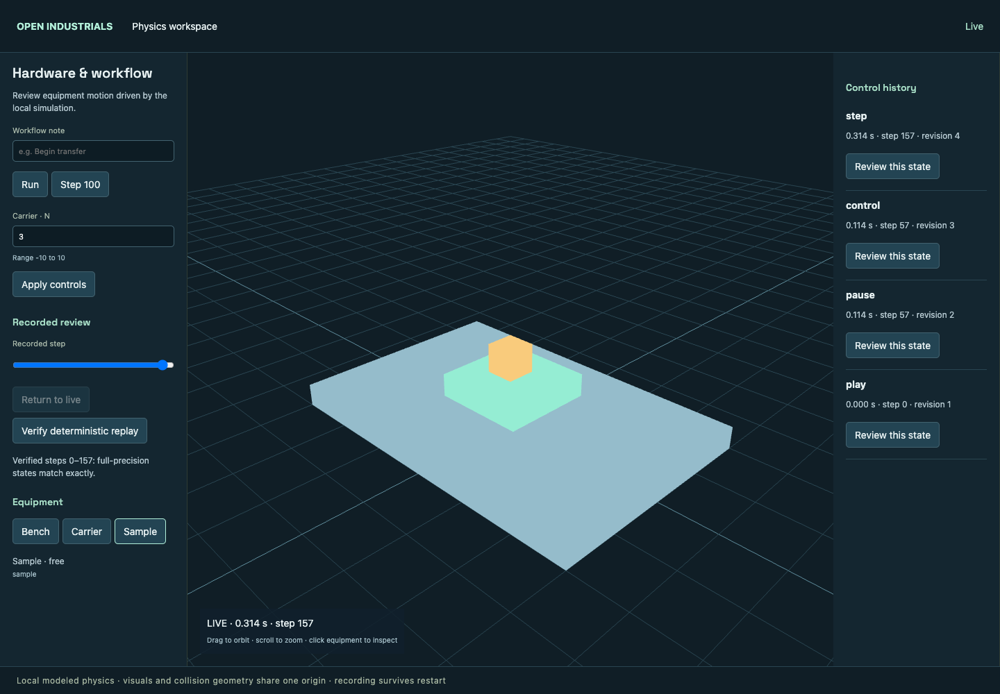
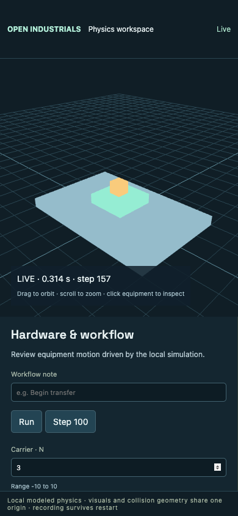

# CAID integration verification

Local verification completed on 2026-10-24 on macOS arm64, Node 24.19.0,
Python 3.12, MuJoCo 3.6.0, CoACD 1.0.14 and NumPy 2.2.6. See
[source revisions and scope](upstream-integration.md) and
[physics setup and contracts](physics-workspace.md).

| Area | Evidence | Result |
| --- | --- | --- |
| Build | TypeScript workbench/MCP/shared simulation checks and production Vite build | Passed |
| Shared simulation | 112 tests covering transactions, jobs, resources, native accounts, authorized history, game/non-game adoption and deployment recovery | Passed, 0 skipped |
| Materials | 16 library tests plus material-authority scenarios | Passed |
| Game authority | Robot routes, sensing, mirrored world, all waste families, native sessions, autonomous scheduling, process kill/restart and immutable retries | Passed |
| Manufacturing | Full machine chain, graded/reclaimed stock, power, charging, reservation rollback, cancellation and restart | Passed |
| Units | Manufactured turrets/launcher, ammunition, ownership, repair, destruction and salvage | Passed |
| Combat | Two-player authoritative movement/damage/capture/retreat and offline restart | Passed |
| Victory | Actual recovered stock through launcher/ammunition manufacture to tower destruction, durable result and post-match rejection | Passed |
| FIELD-LAB | Durable execution matches all six frozen scenario timelines and finite-resource accounting | Passed |
| Scenes and agents | Local SQLite restart; MCP scenes; SQL revision history and ownership; Grok/ChatGPT/Codex protocol fixtures and cross-client handoff | Passed; local fixtures, no live model/cloud calls |
| Workbench browser | Project import/export, Form handoffs, animation/GIF pixels, room transitions, stale-response fencing and desktop/mobile layouts | Passed with CAID branding |
| Physics | 9 Python tests, including origin preservation, separate concave hulls, contacts, byte-exact Float64 replay, corrupted history, transactional rollback, process restart, worker lock and request boundaries | Passed |
| Pose protocol | Float32 binary decoding, lengths, body counts, finite values and quaternion validation | Passed |
| Physics browser | Workbench HTTP/WebSocket proxy, controls, committed-but-lost response/retry, recorded review, replay, reload, desktop/mobile | Passed in installed Chrome |
| Geospatial contracts | 8 Python tests for binding, axes, geographic transforms and deterministic export | Passed |
| GLB / 3D Tiles | 21 GLBs and tileset checked by glTF Validator and 3D Tiles Validator | 0 errors, 0 warnings |
| Geospatial viewers | CesiumJS and independent Three.js tiles renderer load and pick the exported pipette | Passed |

The new physics workflow runs Python/runtime and browser checks on Linux,
Windows and macOS. Existing upstream workflows cover the imported runtime,
FIELD-LAB, scenes and geospatial export. GitHub Actions results are recorded on
the pull request; local results above do not claim cross-platform CI success.

Desktop evidence:

Mobile evidence:

Replay is verified in the recorded engine/platform environment. The demonstration
uses newly authored geometry and explicit modeled physical parameters; it is not
real-instrument validation. Static 3D Tiles describe the initial geographic layout;
live poses are streamed separately in the local frame. No npm/PyPI package,
release, production deployment or live database migration was performed.
